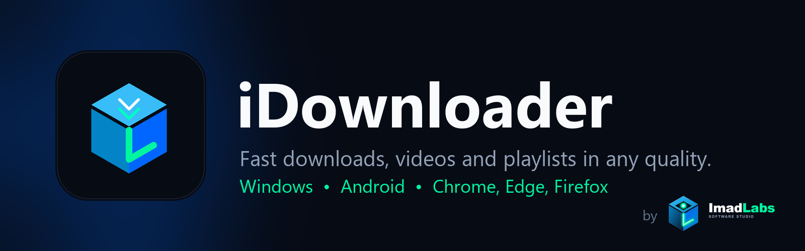
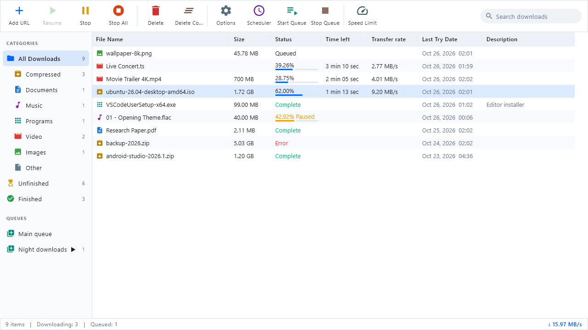
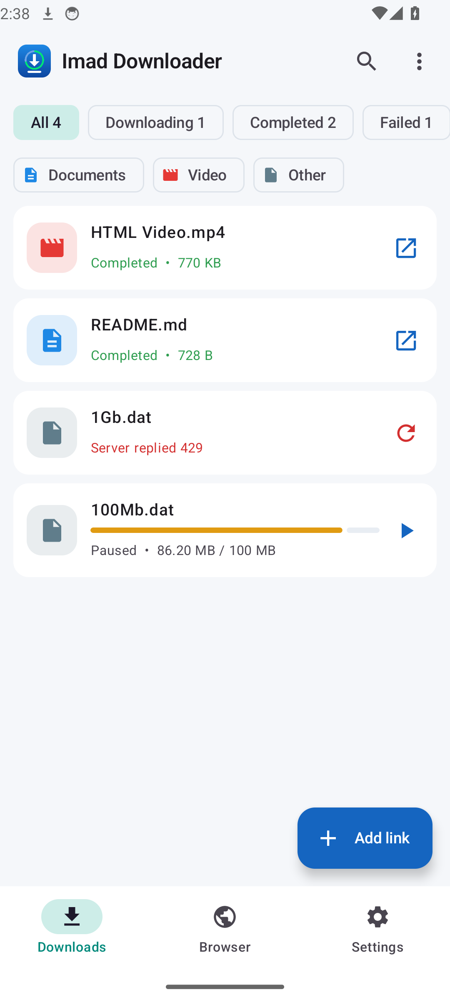
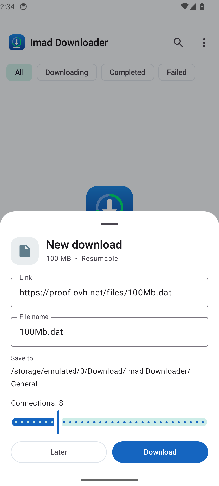
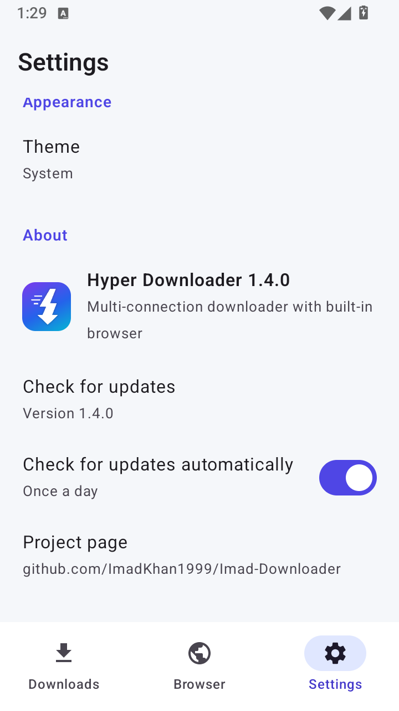

# iDownloader



By **ImadLabs**. News and updates: [t.me/ImadLabs](https://t.me/ImadLabs)

A full download manager for **Windows** (inspired by IDM) and **Android** (inspired by 1DM,
with a built-in browser). Both apps share one Kotlin download engine.



<p>



</p>

## Features

**Engine (both apps)**
- Up to 32 connections per file with IDM-style dynamic segmentation
- Pause and resume, also after closing the app or a crash
- Automatic retries; busy servers (429/503) get fewer connections instead of failing
- Speed limiter (global and per download), queues, daily scheduler
- HLS (`.m3u8`) and DASH (`.mpd`) video streams with a quality picker; separate video and audio are joined into one MP4; AES-128 HLS supported
- YouTube and 1000+ other sites through yt-dlp, with a quality list (video and audio joined into one MP4)
- YouTube playlists: tick the videos you want, pick one quality (or audio only) for all of them
- Batch downloads (`file[001-100].jpg`), checksums, smart file names, category folders
- In-app updates on both apps (download with progress, verified, then installed)

**Windows**
- IDM layout: toolbar, category tree, sortable/resizable list, right-click menu, shortcuts
- File info dialog, progress window with connection map, completion dialog
- Options, Scheduler (exit / sleep / shut down when a queue finishes), batch and link lists
- Clipboard capture, system tray, notifications, start with Windows, light/dark theme
- Chrome / Edge extension: takes over downloads, right-click "Download with iDownloader",
  "Download all links", finds videos and shows a "Download this video" button

**Android**
- Download list with filters, categories, details sheet, share/open, foreground service
- Built-in browser with tabs, incognito, bookmarks, history, desktop mode, find in page, ad blocker
- Detects videos and audio on pages (floating button with count) and catches page downloads
- Long-press links to download, share links from any app, copied-link offer, Wi-Fi only mode
- Queues and schedule screen; scheduled queues start even when the app is closed

## Download

See the [Releases](https://github.com/ImadKhan1999/Imad-Downloader/releases) page:
`iDownloader-<version>.exe` or `.msi` for Windows, `iDownloader-<version>.apk` for
Android, `idownloader-chromium-<version>.zip` (Chrome, Edge, Brave, Opera, Vivaldi) and
`idownloader-firefox-<version>.zip` for the browser extension. The Windows app ships both and
adds them for you: it finds the browsers on the PC on first start (and in Help > Connect
browsers...) and walks through adding the extension to each one.

## Build and test

Requires JDK 17 and the Android SDK.

```
gradlew.bat :core:test :desktop:test :androidApp:testDebugUnitTest
gradlew.bat :androidApp:connectedDebugAndroidTest     (with an emulator running)
gradlew.bat :desktop:packageMsi :desktop:packageExe :androidApp:assembleRelease
node extension\build.mjs                             (Chromium + Firefox builds in extension\dist)
node extension\test\e2e.mjs                          (CHROME_PATH = Chrome for Testing; npm install in extension\test first)
node extension\test\e2e-firefox.mjs                  (real Firefox through geckodriver)
```

| Folder | What it is |
| --- | --- |
| `core/` | Shared download engine |
| `desktop/` | Windows app (Compose Desktop) |
| `androidApp/` | Android app (Jetpack Compose) with built-in browser |
| `extension/` | Chrome / Edge extension |
| `branding/` | Logo source and generator |
| `docs/` | Decisions, progress log, test results, chat log, screenshots |

Release signing: put `keystore/imad-release.jks` and `keystore/release.properties` next to the
project (both are git-ignored). Without them the release APK is signed with the debug key.

iDownloader was called Imad Downloader (up to 1.3.0) and iDownloader (1.4.0 to 1.5.1).
Updating keeps your settings, download list and files.
