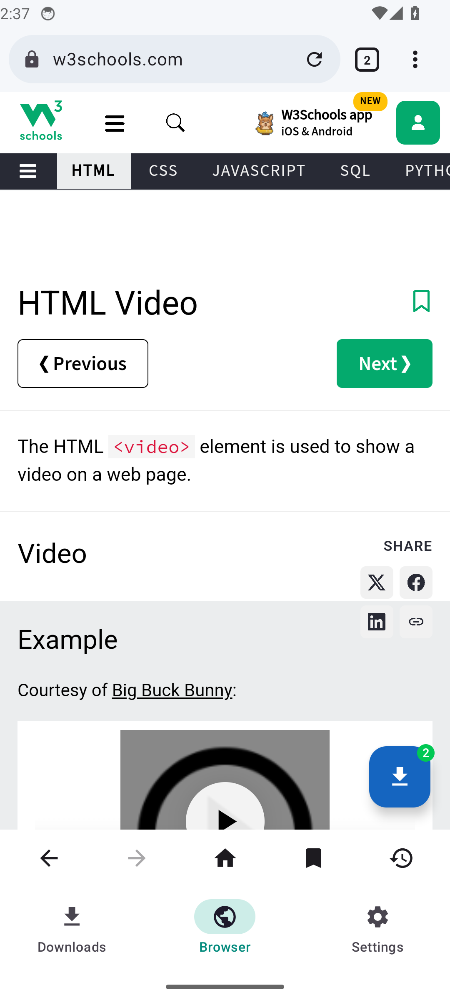
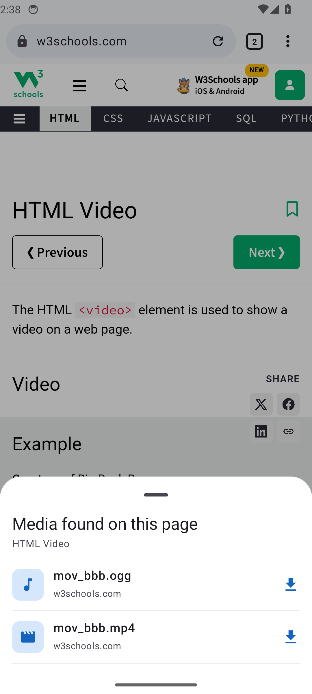

# Imad Downloader

A full download manager for **Windows** (inspired by IDM) and **Android** (inspired by 1DM,
with a built-in browser). Both apps share one Kotlin download engine.


<p>



</p>

## Features

**Engine (both apps)**
- Up to 32 connections per file with IDM-style dynamic segmentation
- Pause and resume, also after closing the app or a crash
- Automatic retries; busy servers (429/503) get fewer connections instead of failing
- Speed limiter (global and per download), queues, daily scheduler
- HLS video streams (`.m3u8`) including AES-128 encryption
- Batch downloads (`file[001-100].jpg`), checksums, smart file names, category folders

**Windows**
- IDM layout: toolbar, category tree, sortable/resizable list, right-click menu, shortcuts
- File info dialog, progress window with connection map, completion dialog
- Options, Scheduler (exit / sleep / shut down when a queue finishes), batch and link lists
- Clipboard capture, system tray, notifications, start with Windows, light/dark theme
- Chrome / Edge extension: takes over downloads, right-click "Download with Imad Downloader",
  "Download all links", finds videos and shows a "Download this video" button

**Android**
- Download list with filters, categories, details sheet, share/open, foreground service
- Built-in browser with tabs, incognito, bookmarks, history, desktop mode, find in page, ad blocker
- Detects videos and audio on pages (floating button with count) and catches page downloads
- Long-press links to download, share links from any app, copied-link offer, Wi-Fi only mode

## Download

See the [Releases](https://github.com/ImadKhan1999/Imad-Downloader/releases) page:
`Imad Downloader-<version>.exe` or `.msi` for Windows, `ImadDownloader-<version>.apk` for
Android, `ImadDownloader-extension-<version>.zip` for Chrome/Edge (also inside the Windows app
folder; Options > Browser Integration shows where).

## Build and test

Requires JDK 17 and the Android SDK.

```
gradlew.bat :core:test :desktop:test :androidApp:testDebugUnitTest
gradlew.bat :androidApp:connectedDebugAndroidTest     (with an emulator running)
gradlew.bat :desktop:packageMsi :desktop:packageExe :androidApp:assembleRelease
node extension\test\e2e.mjs                          (after npm install in extension\test)
```

| Folder | What it is |
| --- | --- |
| `core/` | Shared download engine |
| `desktop/` | Windows app (Compose Desktop) |
| `androidApp/` | Android app (Jetpack Compose) with built-in browser |
| `extension/` | Chrome / Edge extension |
| `branding/` | Logo source and generator |
| `docs/` | Decisions, progress log, test results, chat log, screenshots |

Release signing: put `keystore/imad-release.jks` and `keystore/release.properties` next to the
project (both are git-ignored). Without them the release APK is signed with the debug key.
